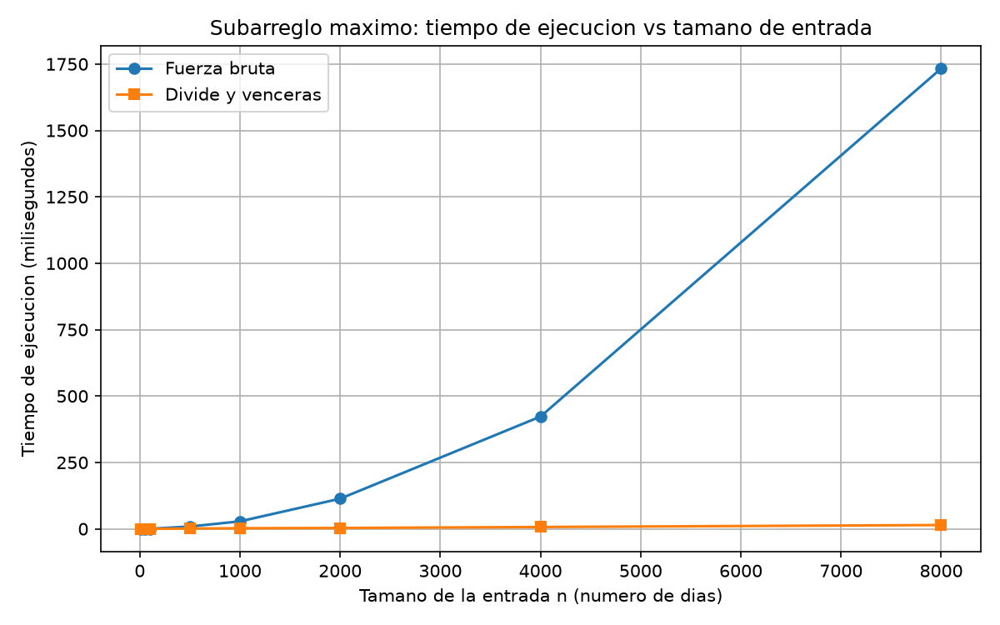
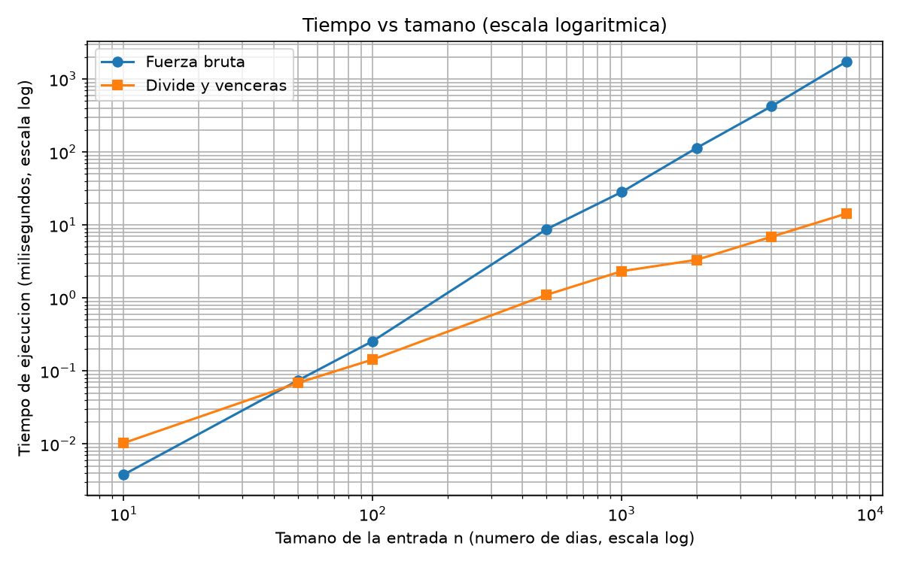

# Laboratorio 2 — Dividir y vencer

## Samuel Arango Montoya

## Cómo reproducir el experimento

Desde la raíz del repositorio:

```powershell
.\venv\Scripts\Activate.ps1
cd laboratorios\lab2-divide-y-vencer
python pruebas.py
python medicion.py
```

## Parte 1 — Implementación y verificación

Código: [subarreglo.py](subarreglo.py) · [pruebas.py](pruebas.py)

Implementé el subarreglo máximo de dos formas:

- **Fuerza bruta** (`subarreglo_fuerza_bruta`): dos ciclos anidados que
  recorren todos los pares de días (i, j). La suma se acumula dentro del
  ciclo interno en lugar de recalcularla, por lo que el costo es Θ(n²).
- **Divide y vencerás** (`subarreglo_maximo`): el caso base es `inicio == fin`
  (un solo elemento). En otro caso divide el rango en `inicio..medio` y
  `medio + 1..fin`, resuelve cada mitad recursivamente, calcula el tramo
  cruzado con `suma_cruzada` y devuelve el mejor de los tres. No llama a la
  fuerza bruta. `suma_cruzada` hace un barrido lineal desde `medio` hacia la
  izquierda y otro desde `medio + 1` hacia la derecha, de modo que el tramo
  siempre incluye al menos un elemento de cada lado.

Ninguna función modifica la lista recibida.

### Cómo verifiqué las soluciones

En `pruebas.py` uso `assert` y comparo **la suma**, no los índices, porque
puede haber varios tramos con la misma suma máxima. Casos cubiertos:

| Caso | Serie | Suma esperada |
|---|---|---|
| Ocho días de la situación problema | `[-3, 5, -2, 8, -6, 3, 9, -4]` | 17 |
| Un solo elemento | `[7]` y `[-7]` | 7 y -7 |
| Todos negativos | `[-8, -3, -6, -2, -5]` | -2 |
| Todos positivos | `[4, 1, 7, 3, 2]` | 17 |
| Mejor tramo cruza el punto medio (índices 2..5) | `[1, -5, 4, 3, 2, 5, -6, 1]` | 14 |

Además:

- Probé `suma_cruzada` directamente: en la serie de ocho días da 17, y en
  `[-4, -1, -2, -9]` da -3, lo que confirma que el tramo cruzado toma un
  elemento de cada lado aunque sean negativos.
- Comprobé que los índices devueltos son coherentes con la suma declarada
  (`sum(serie[ini:fin + 1]) == suma`).
- Comprobé que las funciones no modifican la lista de entrada.
- Generé 200 listas aleatorias (semilla fija `42`, longitud entre 1 y 60,
  valores entre -50 y 50) y verifiqué que ambas funciones dan la misma suma
  y que los índices de divide y vencerás corresponden a esa suma.

Todas las pruebas pasan: el script termina imprimiendo
`Todas las pruebas pasaron`.

## Parte 2 — Medición y gráfica

Código: [medicion.py](medicion.py)





### Cómo medí

Cronometré con `time.perf_counter()` únicamente la llamada al algoritmo;
los datos se generan antes, fuera del cronómetro. Los datos son enteros
entre -100 y 100 generados con la semilla fija 42, y en cada tamaño ambos
algoritmos reciben la misma lista.

Repetí cada medición y reporto la **mediana**, porque los tiempos de pocos
milisegundos fluctúan por el ruido del sistema operativo y la mediana
resiste los valores atípicos. La fuerza bruta se repitió 200 veces para
n ≤ 100, 20 veces para 100 < n ≤ 1000 y 3 veces para n > 1000 (2000, 4000 y 8000), 
donde cada corrida ya es larga. Divide y vencerás se repitió 21 veces en todos los
tamaños. Dentro del propio experimento, después de cronometrar, verifico con assert 
que en cada tamaño ambos algoritmos devuelven la misma suma. Esa comprobación queda fuera del cronómetro. 

### Tiempos medidos

| n | Fuerza bruta (ms) | Divide y vencerás (ms) |
|---:|---:|---:|
| 10 | 0,0038 | 0,0103 |
| 50 | 0,0739 | 0,0685 |
| 100 | 0,2564 | 0,1434 |
| 500 | 8,7769 | 1,1051 |
| 1000 | 28,2785 | 2,3262 |
| 2000 | 113,5658 | 3,3321 |
| 4000 | 422,7681 | 6,9088 |
| 8000 | 1733,4116 | 14,3354 |
