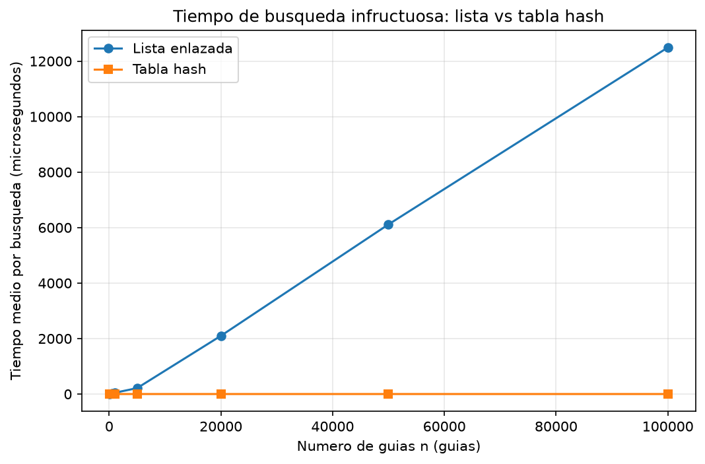
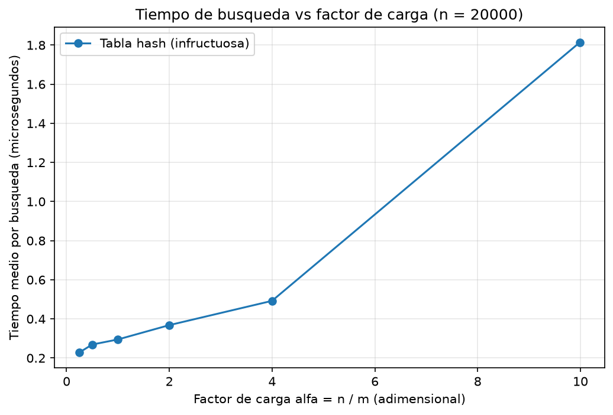

# Laboratorio 3 — Estructuras de datos: lista enlazada vs. tabla hash

**Autor:** Samuel Arango Montoya

**Caso:** Rutas del Caribe, consulta de guías de envío.

## Cómo reproducir

Requiere Python 3.10 o superior (se usan las anotaciones `Nodo | None`). El entorno virtual `venv` y el archivo `requirements.txt` (con `matplotlib`) están en la **raíz del repositorio**.

```powershell
# 1. Desde la raíz del repositorio, activar el entorno virtual
venv\Scripts\Activate.ps1

# 2. Instalar las dependencias (requirements.txt está en la raíz)
pip install -r requirements.txt

# 3. Entrar a la carpeta del laboratorio
cd laboratorios\lab3-estructuras-datos

# 4. Ejecutar las pruebas (debe imprimir "Todas las pruebas pasaron.")
python pruebas.py

# 5. Ejecutar la medición (imprime las tablas y regenera graficas/*.png)
python medicion.py
```

La medición usa semillas fijas (`SEMILLA = 2026`), así que genera siempre las mismas guías. Los tiempos absolutos dependen de la máquina, pero la forma de las curvas debe ser la misma.

---

## Parte 1 — Implementación y verificación

Código: [`estructuras.py`](estructuras.py) · Pruebas: [`pruebas.py`](pruebas.py)

`estructuras.py` contiene `Nodo`, `ListaEnlazada` (inserción al inicio en Θ(1), búsqueda iterativa con `while`) y `TablaHash` (encadenamiento, `h(k) = k mod m`). Cada casilla de la tabla es una `ListaEnlazada`; no se usa `dict`, `set` ni la función `hash()` de Python.

`pruebas.py` verifica con `assert`:

1. **Búsqueda exitosa e infructuosa** en la lista y en la tabla (guía 24 existe; guía 99 devuelve `None`).
2. **Colisión forzada con m = 7:** las guías 10, 24 y 17 caen las tres en la casilla 3 (`hash == 3`), la lista de esa casilla tiene longitud 3 y las tres se recuperan con su estado correcto.
3. **Factor de carga:** `factor_carga() == 3 / 7` y `tamano == 3` tras esas inserciones.
4. **25 colecciones aleatorias** (semilla 42, de 1 a 500 guías, con `m` elegido entre 7, 101 y 1009): ambas estructuras tienen el mismo tamaño, devuelven el estado correcto para todas las guías existentes y devuelven `None` para 10 guías inexistentes (sin repetir) por colección. Los valores `m = 7` y `101` fuerzan cadenas largas.

Además, `medicion.py` repite una verificación dentro de cada experimento: antes de cronometrar, comprueba en una muestra de 100 guías existentes que lista y tabla devuelven el mismo estado.

---

## Parte 2 — Medición y gráficas

Código: [`medicion.py`](medicion.py)

**Cómo medí.**

- Guías: enteros distintos de diez dígitos, generados con semilla fija y **las mismas guías para lista y tabla** en cada valor de n. Los estados se asignan de forma rotativa entre "en bodega", "en reparto" y "entregado".
- Se cronometran **únicamente** las búsquedas, con `time.perf_counter()`; la construcción de las estructuras y la generación de datos quedan fuera.
- Cada medición hace **200 búsquedas de guías inexistentes** (las genera `generar_guias_inexistentes`, con semilla fija) y se **repite 5 veces**; se reporta el promedio, en microsegundos por búsqueda.
- Experimento A: `m` = primo más cercano (por encima) a n/2, de modo que α ≈ 2.
- Experimento B: n = 20.000 fijo; `m` = primo cercano a n/α para α meta ∈ {0,25; 0,5; 1; 2; 4; 10}.

### Experimento A — lista vs. tabla (búsquedas infructuosas)



| n | m | α | Lista (µs) | Tabla (µs) |
|---:|---:|---:|---:|---:|
| 100 | 53 | 1,89 | 4,202 | 0,228 |
| 500 | 251 | 1,99 | 23,497 | 0,289 |
| 1.000 | 503 | 1,99 | 46,547 | 0,296 |
| 5.000 | 2.503 | 2,00 | 212,817 | 0,297 |
| 20.000 | 10.007 | 2,00 | 2098,516 | 0,357 |
| 50.000 | 25.013 | 2,00 | 6114,578 | 0,435 |
| 100.000 | 50.021 | 2,00 | 12490,318 | 0,452 |

### Experimento B — efecto del factor de carga (n = 20.000)



| α meta | m | α real | Tabla (µs) |
|---:|---:|---:|---:|
| 0,25 | 80.021 | 0,250 | 0,229 |
| 0,5 | 40.009 | 0,500 | 0,269 |
| 1 | 20.011 | 0,999 | 0,295 |
| 2 | 10.007 | 1,999 | 0,368 |
| 4 | 5.003 | 3,998 | 0,492 |
| 10 | 2.003 | 9,985 | 1,813 |

---

## Parte 3 — Análisis

### 1. Costo teórico

**Lista.** Una guía inexistente solo se descarta tras compararla con los n nodos, así que el costo siempre es n comparaciones: Θ(n).

**Tabla.** Calcular `k mod m` cuesta Θ(1); luego se recorre solo la cadena de esa casilla. Si la función hash es **uniforme simple** (cada guía cae en cualquiera de las m casillas con probabilidad 1/m, de forma independiente), la cadena mide en promedio n/m = α, y la búsqueda infructuosa cuesta Θ(1 + α). Con m proporcional a n, α es constante y el costo es Θ(1).

**Si el supuesto falla.** Si todas las guías cayeran en la misma casilla, la tabla sería una sola lista de n nodos: Θ(n), igual que la lista enlazada.

### 2. Lo medido contra lo esperado

**Gráfica 1.** De n = 50.000 a 100.000 (n ×2) la lista pasó de 6114,6 a 12490,3 µs: **×2,04**, coherente con Θ(n). De 20.000 a 50.000 (n ×2,5) pasó de 2098,5 a 6114,6 µs: ×2,91, algo más que lineal; de 5.000 a 20.000 (n ×4) el salto fue ×9,9. Probablemente son efectos de caché (hipótesis, no la medí). En el primer tramo la tabla pasó de 0,435 a 0,452 µs: **×1,04**, coherente con Θ(1) (α ≈ 2 constante). Entre n = 100 y 100.000 (×1000) solo se multiplicó por ~2.

**Gráfica 2.** Con n fijo, el tiempo crece con α: 0,229 µs (α = 0,25), 0,295 (α ≈ 1), 0,492 (α ≈ 4) y 1,813 (α ≈ 10). Hay una constante cercana a 0,2 µs (el Θ(1)) más un término que crece con α, coherente con Θ(1 + α). No es perfectamente lineal: de α = 4 a 10 el tiempo se multiplica ×3,7, y 1 + α predice ×2,2 (hipótesis: las cadenas largas, con nodos dispersos en memoria, cuestan más por nodo).

### 3. Colisiones

Una **colisión** ocurre cuando dos guías distintas tienen el mismo `h(k)`. Sucede aunque m > n porque hay muchas más guías posibles que casillas y, al repartirse al azar, unas casillas reciben varias guías y otras ninguna (paradoja del cumpleaños: se esperan ≈ n²/(2m) pares en colisión). Ejemplo: con m = 7, 10 mod 7 = 24 mod 7 = 17 mod 7 = 3.

- **Encadenamiento** (el implementado): la casilla 3 guarda una lista con 17, 24 y 10. *Ventaja:* nunca se llena y admite α > 1. *Costo:* punteros extra, más memoria y peor localidad de caché.
- **Direccionamiento abierto:** todo vive en el arreglo; con sondeo lineal, 10 ocupa la casilla 3, 24 la 4 y 17 la 5. *Ventaja:* sin punteros y con mejor localidad. *Costo:* exige α < 1, sufre agrupamiento, el borrado requiere marcas y se degrada bruscamente cerca de α = 1.

### 4. Tabla hash o árbol de búsqueda

**La tabla no sirve para rangos.** `k mod m` dispersa las guías: dos consecutivas quedan en casillas lejanas y no hay orden. Habría que revisar las n guías: Θ(n + m).

**El ABB sí:** busca X en Θ(h) y recorre en orden hasta Y: Θ(h + k) para k guías en el rango.

**Guías ya ordenadas.** Cada guía nueva va a la derecha de la anterior y el árbol degenera en lista: altura ≈ 400.000, ≈ 400.000 comparaciones por búsqueda infructuosa y ≈ n²/2 ≈ 8×10¹⁰ para construirlo. En un árbol equilibrado la altura es ⌊log₂ 400.000⌋ = 18 y una búsqueda hace ≈ 19 comparaciones, unas 21.000 veces menos.

### 5. Concepto para la jefa de operaciones

**Recomendación:** una combinación. Tabla hash (α ≈ 2) para la consulta puntual del call center y árbol de búsqueda equilibrado (AVL o rojo-negro) para el rango; ambos se actualizan en cada alta. Si hubiera que elegir una sola, el árbol cubre las dos necesidades con Θ(log n), pero con consulta puntual más lenta.

**Estimación para n = 5.000.000** (es una estimación, no una medición; no implementé el árbol):

- *Lista:* la curva es lineal, pero el costo por nodo no fue constante: subió de 0,043 µs (n = 5.000) a 0,122 (n = 50.000) y se estabilizó en 0,125 (n = 100.000). Con ≈ 0,125 µs por nodo, 5×10⁶ nodos dan ≈ **0,6 s**; si el costo por nodo siguiera subiendo, hasta ≈ 1 s.
- *Tabla (α = 2, ≈ 2,5 millones de casillas):* la forma es Θ(1), no una regla de tres. De n = 5.000 a 100.000 (×20) solo subió de 0,297 a 0,452 µs (hipótesis: efecto de la memoria). Estimo **≈ 0,5 a 1 µs**. En Python, 2,5 millones de objetos `ListaEnlazada` más 5 millones de nodos ocupan mucha memoria (probablemente cientos de MB), lo que apoya que el tiempo no baje de esa cifra.
- *Árbol equilibrado:* altura ⌊log₂ 5×10⁶⌋ = 22, unas 23 comparaciones. Con 0,1 a 0,15 µs por nodo (el costo medido en la lista; el árbol tiene peor localidad) estimo **≈ 2 a 4 µs**, cerca de la tabla y muy lejos de la lista.
- Con estas estimaciones, la lista sería entre 600.000 y 2 millones de veces más lenta que la tabla. Valen para mi equipo y mi implementación en Python.